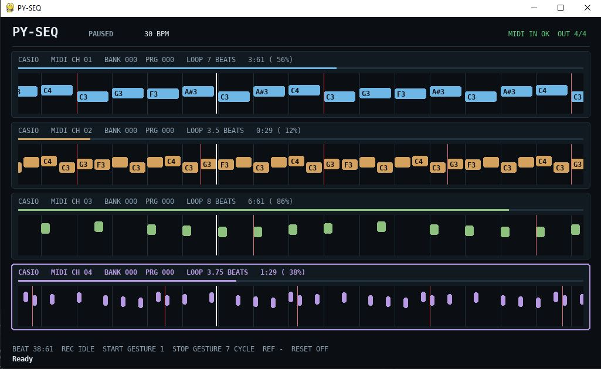

# py-seq

A four-channel MIDI looper with independent loops and a Pygame interface.



## Current behavior

- Shared monotonic transport with independent four-channel loop lengths/phases
- MIDI input and loop playback through selected output routes
- Immediate, beat-, reference-loop-, and first-note-synchronized recording
- Overdub and overwrite recording, with loop state held in memory
- Optional Pygame interface; host timing is independent of GUI redraws

The global position is displayed as zero-based beats with a rounded 1/64-beat
fraction. This display does not reduce internal tick precision.

## Fresh installation

Python 3.12 is required (`.python-version` pins 3.12.3). Create a project virtual environment, then install the project in editable mode. This installs the dependencies declared in `pyproject.toml`, including Mido, python-rtmidi, and pytest.

### Windows PowerShell

From the project directory:

```powershell
py -3.12 --version
py -3.12 -m venv .venv
.\.venv\Scripts\Activate.ps1
python -m pip install --upgrade pip
python -m pip install -e .
```

If PowerShell blocks virtual-environment activation, allow activation for the
current user or invoke `.venv\Scripts\python.exe` directly for the pip and run
commands.

### Linux

Use an installed Python 3.12 interpreter. On Debian/Ubuntu, the `venv` package may need to be installed for that Python version first.

```bash
python3.12 --version
python3.12 -m venv .venv
source .venv/bin/activate
python -m pip install --upgrade pip
python -m pip install -e .
```

If `python-rtmidi` cannot install a compatible wheel and pip attempts a source build, install a C/C++ compiler and the system ALSA development headers first. For Debian/Ubuntu these are commonly provided by `build-essential` and `libasound2-dev`; package names vary by distribution. MIDI hardware is not needed to install the project or run its tests.

After installation on either OS, verify the setup with:

```text
python -m pytest -q
python -m py_seq.pygame_gui --help
```

## Run with MIDI devices

### Pygame GUI

Install the optional GUI dependency with the project, then start the GUI with
the same four-channel MIDI routing and loop-length options:

```bash
python -m pip install -e ".[gui]"
python -m py_seq.pygame_gui --list-midi
python -m py_seq.pygame_gui \
  --midi-in 0 \
  --midi-out 1 0 0 CASIO \
  --midi-out 2 0 1 CASIO \
  --midi-out 3 1 0 DRUMS \
  --midi-out 4 1 1 BASS \
  --length 16 16 8 32 \
  --bpm 120 \
  --fps 15
```

The GUI defaults to 15 FPS. Its host worker advances playback independently of
redraws; MIDI timing does not use GUI-interpolated position. GUI quit requests
orderly looper shutdown, MIDI panic/release, and port cleanup. See
[docs/playback.md](docs/playback.md) for playback and transport behavior,
[docs/recording_pipeline_api.md](docs/recording_pipeline_api.md) for the
recording modules, and [docs/pygame_gui.md](docs/pygame_gui.md) for controls
and commands.

## Testing

Use the existing Python 3.12.3 virtual environment:

```bash
cd ~/git/py-seq
. .venv/bin/activate
python -m pytest -q
```

Tests use fake clocks, the in-memory diagnostic MIDI output, and mocked Mido ports. They do not require hardware or real-time sleeps.

## Code boundaries

- `py_seq/four_channel_session.py` — four-channel loops, recording, and transport state
- `py_seq/gui_runtime.py` and `py_seq/pygame_gui.py` — host worker, UI, and controls
- `playback_scheduler/`, `playback_coordinator/`, `articulator/`, `midi_output/` — playback path
- `pre_processor/`, `recorder/`, `interval_resolver/`, `tape/` — recording path
- `tests/` — pytest suite

The session owns transport and note handling; the GUI is a presentation and
control adapter.
